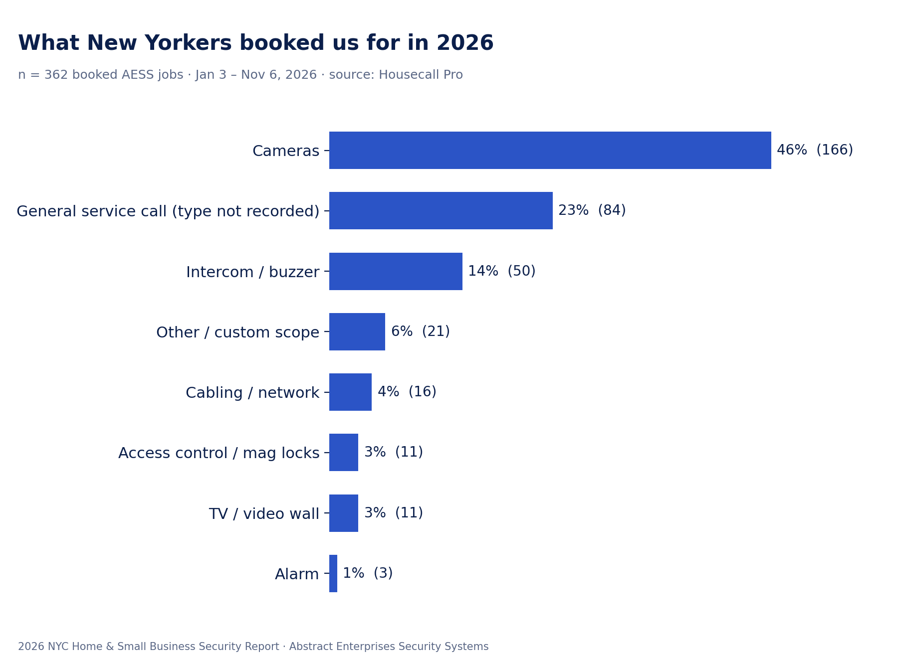
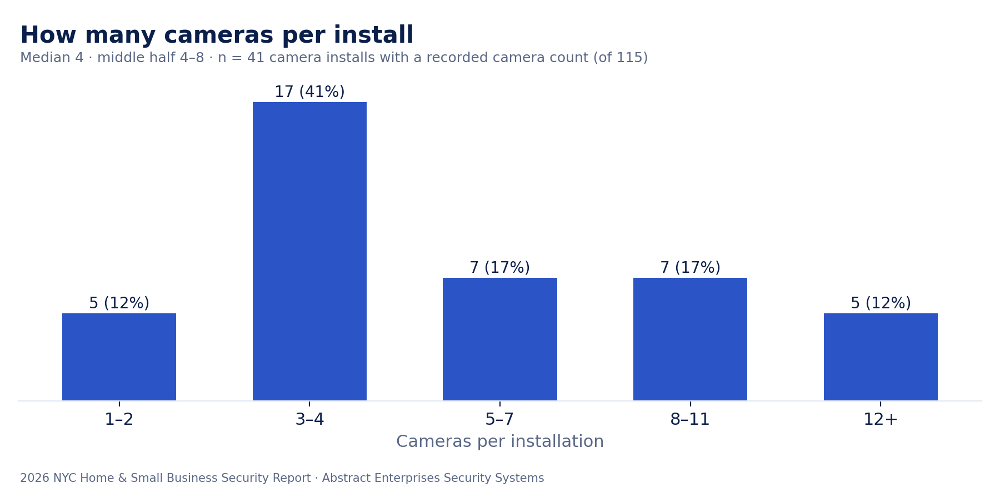
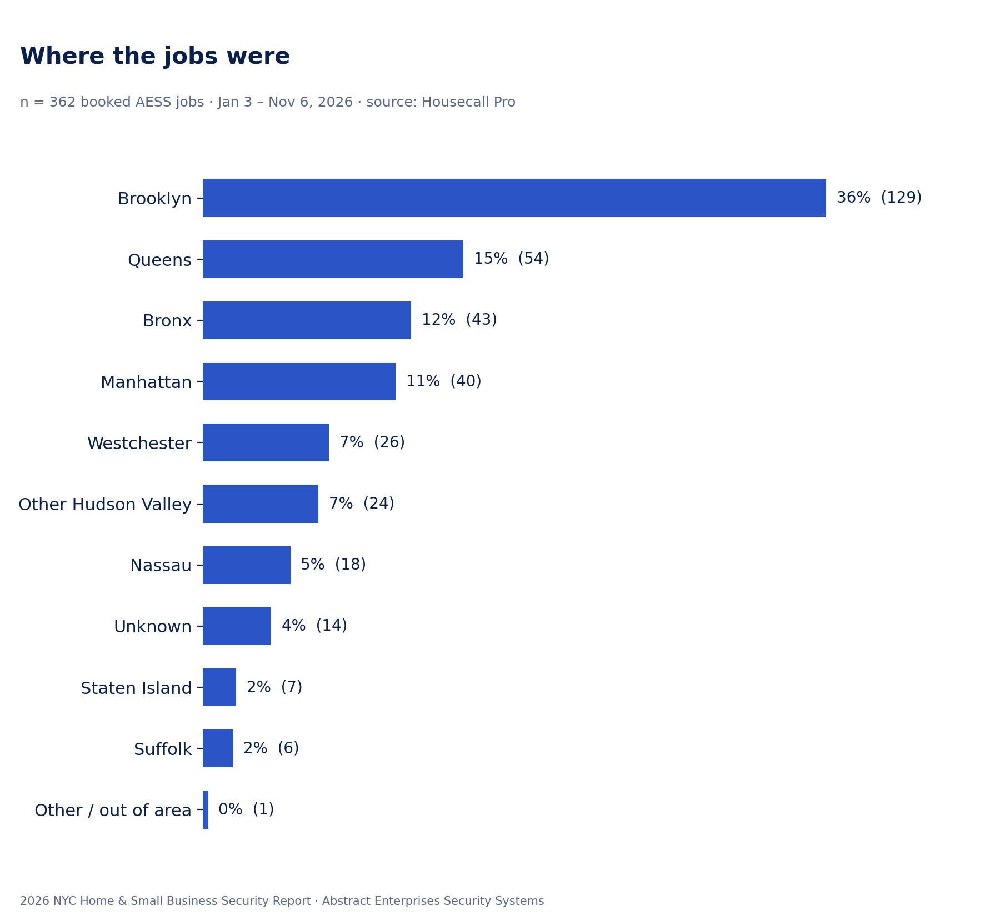
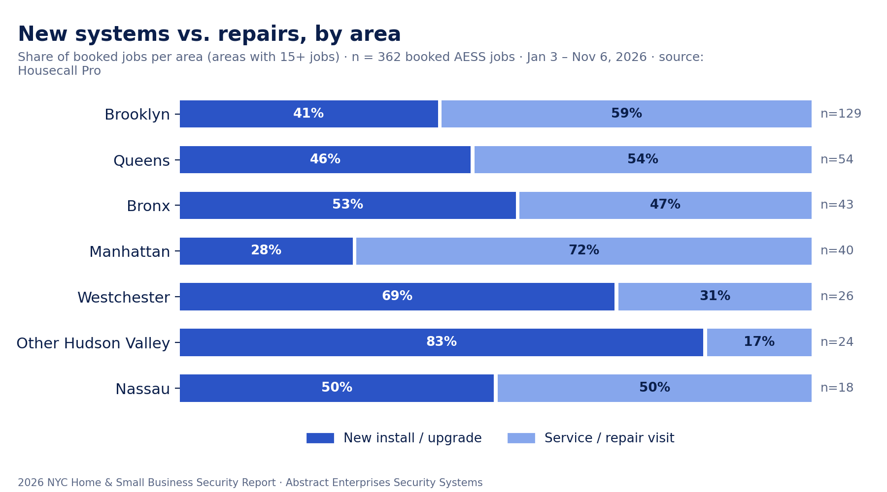
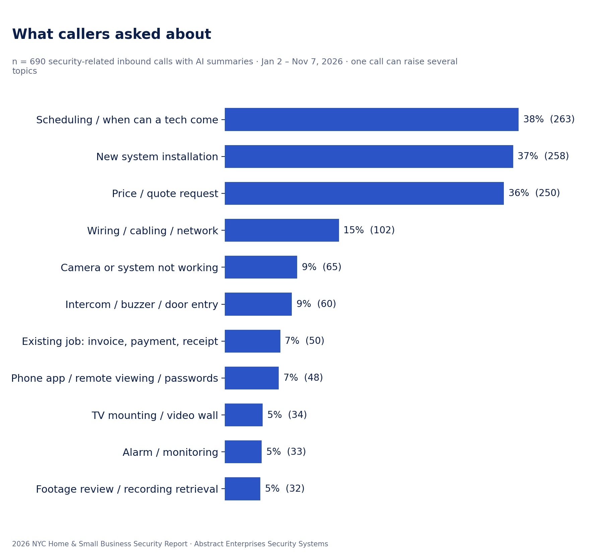
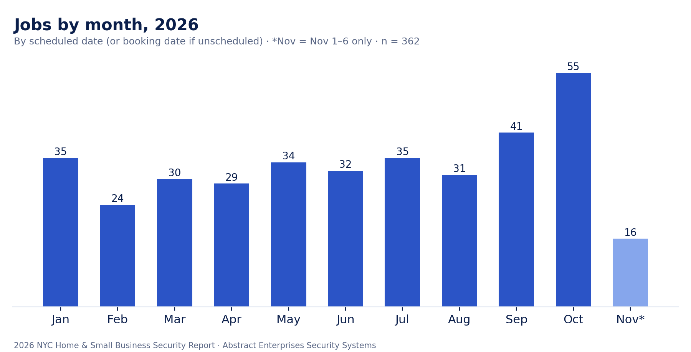

# 2026 NYC Home & Small Business Security Report — Data from 362 AESS Jobs

*Published November 7, 2026 by Abstract Enterprises Security Systems (AESS) — licensed NYS low-voltage contractor, in security since 2000.*

Most "security trends" articles are written from surveys or manufacturer press releases. This one comes from work orders. We pulled every job Abstract Enterprises Security Systems booked between January 3 and November 6, 2026 — 362 jobs across the five boroughs, Long Island, Westchester and the Hudson Valley — plus 690 security-related calls to our phone line, and counted what New Yorkers actually paid to have installed, fixed and explained.

Every figure below states its sample size and date range. Nothing identifies a customer: no names, addresses or individual invoice amounts appear anywhere in this report.

## Key findings

- **Cameras are almost half of all work.** 46% of booked jobs (166 of 362) involved security cameras — new systems, add-ons or repairs. Intercoms and door buzzers were a distant second at 14% (50 jobs).
- **Half of all jobs are repairs, not new systems.** 50% of bookings (180 of 362) were service or repair visits. In Manhattan, repairs were 72% of jobs (29 of 40); in the Hudson Valley outside Westchester, new installs were 83% (20 of 24).
- **Brooklyn is the busiest market by far.** Brooklyn alone produced 36% of jobs (129). The five boroughs together were 75%; Westchester, the rest of the Hudson Valley, Nassau and Suffolk made up most of the remainder.
- **The typical camera system has four cameras.** Among 41 camera installs with a recorded camera count, the median was 4 and the middle half ranged from 4 to 8 cameras. About 3 in 10 (12 of 41) had 8 or more.
- **Buzzers break more than they get replaced.** 64% of intercom and buzzer jobs (32 of 50) were repairs — the highest repair share of any major service.
- **Callers ask "when" as often as "how much."** Of 690 security-related calls, 38% asked about scheduling or how soon a tech could come, 37% about a new installation and 36% about price.
- **Fall is peak season.** October was the busiest month of the year with 55 jobs, and September was second with 41. February was the slowest (24).

## Methodology

**Job data.** We exported every job created in our field-service system (Housecall Pro) from January 1 to November 6, 2026 — 589 job records — and kept the 362 that were actually booked: on the schedule or paid, not canceled, and not a blank placeholder. Each job was classified by service from its job title and invoice line items (camera, intercom/buzzer, access control/mag lock, alarm, cabling/network, TV/video wall). Generic "service call" tickets with no detail recorded were kept as their own group rather than guessed. Jobs were mapped to an area by the ZIP code of the service address. We marked a job as a repair when its title or line items describe a service call, diagnostic, repair, warranty visit or reset; everything else counts as a new install or upgrade.

**Price ranges.** Ranges are the middle half (25th to 75th percentile) of job totals for each service, including sales tax and any add-ons, rounded to the nearest $10 or $50. We only report a range when there are at least 10 jobs behind it. No single job amount is published.

**Call data.** Our phone line is answered by an AI receptionist that writes a short summary of each call. We exported all 3,658 inbound calls from January 1 to November 7, 2026. Of those, 1,663 had a usable summary; after removing personal calls, vendor and marketing pitches and crew coordination, 690 security-related customer calls remained. We counted how many mentioned each topic. One call can raise several topics, so percentages add up to more than 100%.

**Limits.** This is one company's data, not a citywide census. Our mix reflects where we market and the services we offer. Residential versus commercial status was only marked when a business or building name was on the account (28% of jobs, 103 of 362); the other 72% are mostly households but are left unclassified. Camera counts were only recorded on 41 of 115 new camera installs. Data that was too thin — alarm jobs (3), hacked-recorder calls (2) — is noted but not analyzed.

## What New Yorkers are installing

Cameras dominate: 46% of all booked jobs (166 of 362, Jan 3 – Nov 6, 2026). Of those camera jobs, 115 were new systems or add-ons and 51 were repairs.

Intercoms and door buzzers came next at 14% (50 jobs), followed by structured cabling and network drops (4%, 16 jobs), access control and mag locks (3%, 11 jobs) and TV mounting and video walls (3%, 11 jobs). Another 23% (84 jobs) were general service calls where the type wasn't written on the ticket, and 6% (21 jobs) were custom scopes of work that didn't fit one category.

**How big are camera systems?** Among the 41 camera installs where we could read the camera count from the job, the median system had **4 cameras**, and the middle half had **4 to 8**. Four-camera packages were the single most common size (15 of 41). Larger systems are not rare: 12 of the 41 (29%) had 8 cameras or more, and the biggest jobs — multi-family buildings, warehouses and commercial spaces — ran from 12 to 26 cameras.

**What does it cost?** These are the middle-half ranges of what jobs actually totaled, including tax and add-ons:

| Service | Jobs | Middle half of job totals |
|---|---|---|
| New camera system or add-on | 115 | $1,250 – $2,650 |
| Camera service / repair visit | 49 | $160 – $260 |
| Intercom / buzzer repair visit | 32 | $270 – $420 |
| New intercom system | 18 | $680 – $5,150 |
| New cabling / network drops | 12 | $460 – $2,050 |
| TV mounting / video wall | 11 | $330 – $810 |

The intercom range is wide on purpose: it covers everything from replacing one apartment's indoor station to a full building entry system with keypads and fobs.

## Where: borough and county breakdown

Brooklyn produced 36% of all booked jobs (129 of 362). Queens followed with 15% (54), the Bronx with 12% (43) and Manhattan with 11% (40). Staten Island was 2% (7). Together the five boroughs accounted for **75%** of the work.

Outside the city, Westchester was 7% (26 jobs), the rest of the Hudson Valley — Rockland, Orange, Putnam, Dutchess and Ulster — was 7% (24), Nassau 5% (18) and Suffolk 2% (6). About 4% of jobs (14) had no ZIP on file.

## Repairs vs. new systems

Across all 362 jobs, the split was almost exactly even: 180 service or repair visits (50%) and 182 new installs or upgrades (50%).

The split changes sharply with geography:

- **Manhattan was the most repair-heavy area:** 72% of its jobs (29 of 40) were service visits on systems already in place.
- **Brooklyn (59% repairs, 76 of 129) and Queens (54%, 29 of 54)** also leaned toward service work.
- **The suburbs install.** In Westchester, 69% of jobs were new systems (18 of 26); in the rest of the Hudson Valley, 83% (20 of 24). Detached homes and first-time systems are a likely reason.

By service, intercom and buzzer work had the highest repair share (64%, 32 of 50), while cameras were mostly new installs (69% new, 115 of 166).

**Most common repair reasons.** Of the 106 repair visits where the reason was written down (Jan–Nov 2026), the leading causes were: a camera down or not showing a picture (40, including 9 wireless-camera repairs), an intercom, buzzer or door-release fault (31), a recorder (DVR/NVR) diagnosis or hard-drive replacement (9), and door hardware such as a strike, push bar or mag lock (6).

## What callers worry about

Out of 690 security-related calls (Jan 2 – Nov 7, 2026):

- **38% (263) asked about scheduling** — when a tech could come, whether today or this weekend was possible, or rescheduling.
- **37% (258) were about a new installation**, and **36% (250) asked about price** or requested a quote.
- **15% (102) involved wiring, cabling or the home network** — usually where cables would run and whether walls would be opened.
- **9% (65) reported a camera or system that stopped working**, and **9% (60) were about intercoms, buzzers or door entry**.
- **7% (48) needed help with the phone app, remote viewing or a password**, and **5% (32) wanted to pull or review recorded footage** — often after something had already happened.
- **7% (50)** were existing customers asking about an invoice, payment or receipt; **5% (34)** asked about TV mounting or video walls, and **5% (33)** about alarms or monitoring.

The pattern is clear: people call when they want something done soon. Speed and a clear price matter as much as the equipment.

## Seasonality

Jobs by month (n = 362; by scheduled date, or booking date if not yet scheduled): January 35, February 24, March 30, April 29, May 34, June 32, July 35, August 31, September 41, October 55, and November 16 (November 1–6 only).

Work was steady at roughly 30 to 35 jobs a month from spring through summer, dipped in February, and climbed in the fall. October was the busiest month of the year. Part of that jump may reflect fuller record-keeping as the year went on. Shorter days and the run-up to the holidays are a likely reason more people book in the fall.

## What this means for you

**Homeowners.** A four-camera system is the norm, and it covers most front doors, driveways and backyards. Before you call, know where you want coverage and how long you want recordings kept — and decide whether you want the cables hidden in the walls or neatly run on the surface, because that is the single biggest question installers will ask. If you already have a system, keep the app login and recorder password somewhere safe: forgotten passwords and phone-app setup were 7% of all calls.

**Building owners and managers.** Buzzers and intercoms fail far more often than they get replaced — 64% of intercom jobs were repairs. If your building has an older audio system and you are paying for the same door-release fix more than once a year, price out a replacement. When a repair is booked, plan for access to every affected unit on the same visit so the problem can be traced in one trip.

**Small businesses.** Accounts with a business or building name made up 28% of our jobs. Businesses tend to need more cameras than homes, a recorder that keeps footage longer, and sometimes access control on a back or side door. Don't wait for an incident: 5% of callers were trying to recover footage after the fact, and footage you didn't record can't be recovered.

**Everyone.** Fall is our busiest season. If you want work done before the holidays, book in September rather than late October.

## About AESS

Abstract Enterprises Security Systems, Inc. is a licensed New York State low-voltage contractor. Owner Anwar Timothy has worked in security since 2000 and has run the company since 2002 — more than 25 years. AESS installs and repairs security cameras, intercoms and door buzzers, access control and mag locks, alarms, structured cabling and Wi-Fi, TV mounting, video walls and outdoor LED screens across all five NYC boroughs, Nassau, Suffolk, Westchester, Rockland, Orange, Putnam, Dutchess and Ulster. Hours are 8 AM to 8 PM, seven days a week.

Get a price or book a visit at **[abstractenterprisessecuritysystems.com](https://www.abstractenterprisessecuritysystems.com/?utm_source=github&utm_medium=report&utm_campaign=security-report-2026)** or call (800) 486-0943.

*Data sources: AESS Housecall Pro job and invoice records (589 job records created Jan 1 – Nov 6, 2026, of which 362 booked; 506 invoices) and AESS phone-line call summaries (3,658 inbound calls, Jan 1 – Nov 7, 2026). Aggregated by AESS on November 7, 2026. Citation: "2026 NYC Home & Small Business Security Report," Abstract Enterprises Security Systems, November 2026.*
